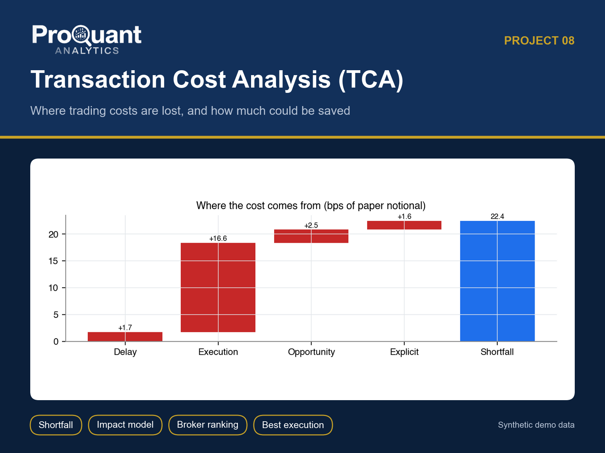
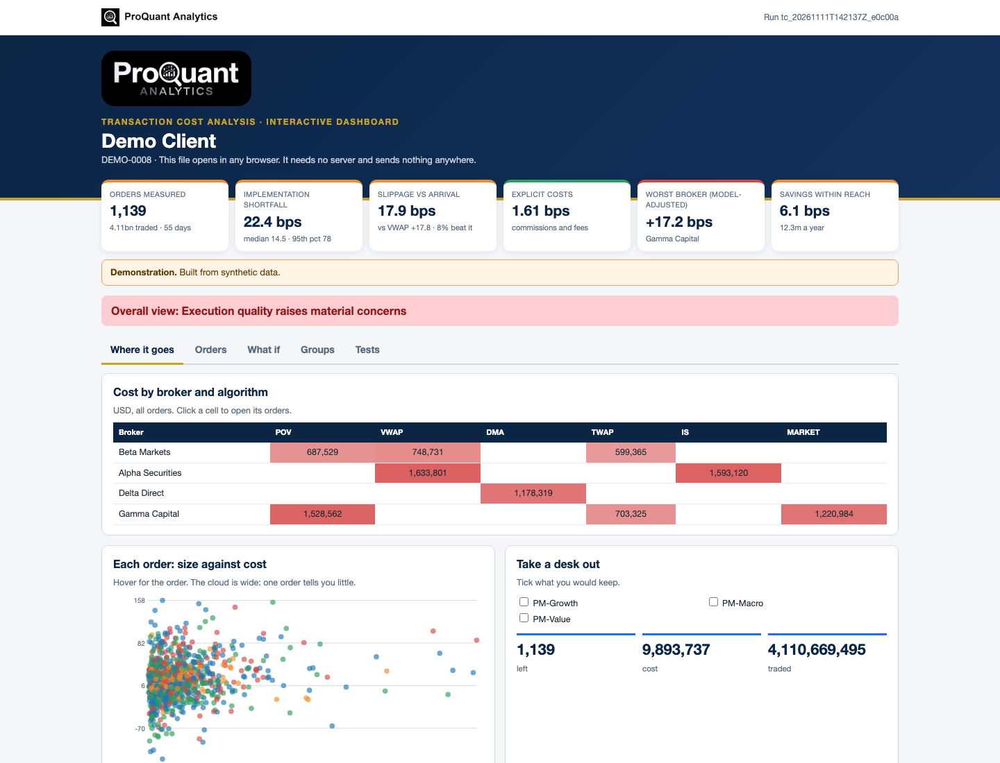
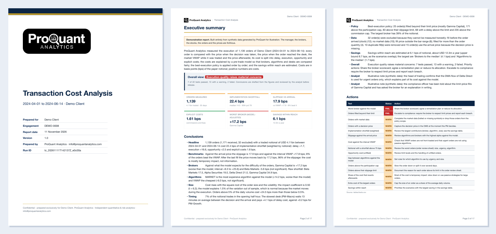
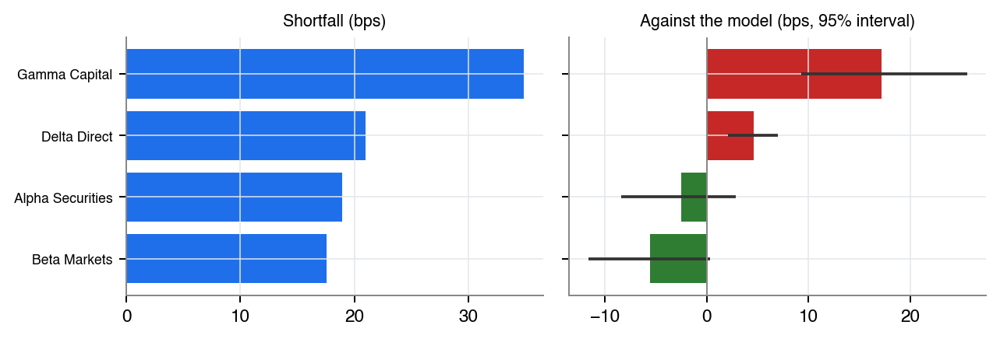
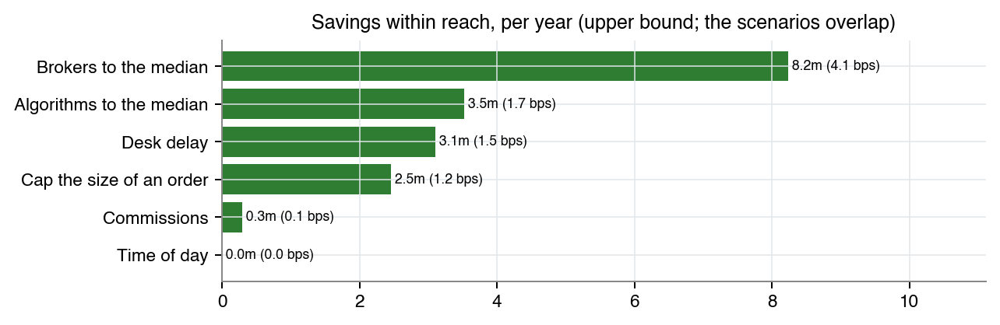
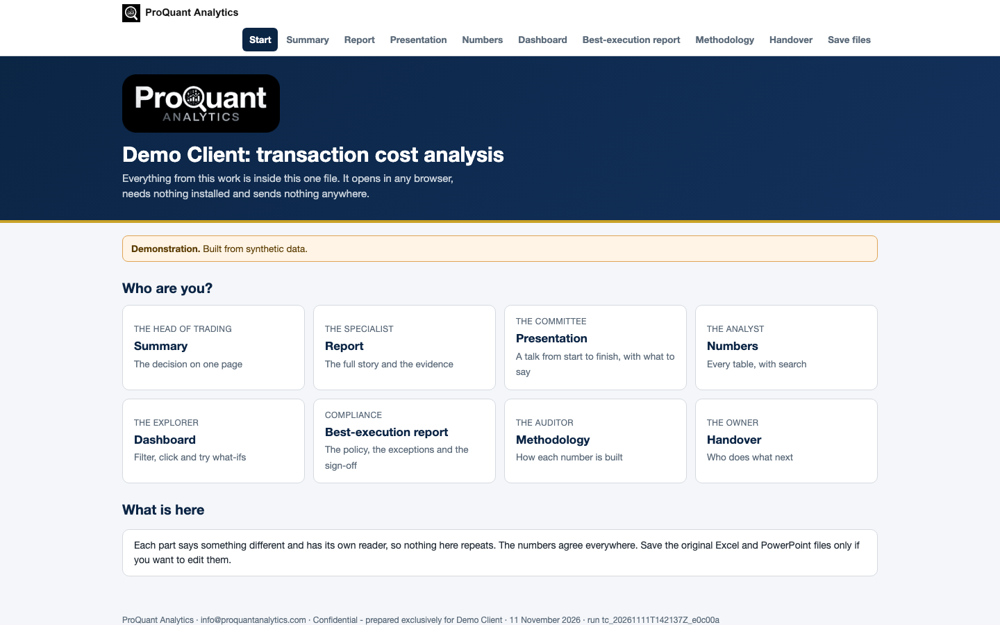

# Transaction Cost Analysis (TCA)

**What trading really costs, where it is lost, who is responsible and how much could be saved.**

  

> **Showcase repository.** It shows the method and the actual files a client receives, built on **synthetic demo data** (a fictional *Demo Client*). The numbers below are illustrative, not client results. The production code is proprietary and is not published here.

## Contents

- [Business problem](#business-problem)
- [Approach](#approach)
- [Results (demo)](#results-demo)
- [Deliverables](#deliverables)
- [Gallery](#gallery)
- [Tech stack](#tech-stack)
- [How to view it](#how-to-view-it)
- [How an engagement works](#how-an-engagement-works)

## Business problem

Desks call execution 'fine' because slippage against the broker's own VWAP is small. Nobody measures from the investment decision, separates waiting from trading, or adjusts for the difficulty of each broker's orders.

**Typical clients:** Asset managers, hedge funds, trading desks and compliance teams with a best-execution obligation.

## Approach

- Implementation shortfall split exactly into delay, execution, opportunity and explicit costs
- Slippage vs arrival, decision, interval VWAP, close and post-trade benchmarks; reversion analysis
- Square-root pre-trade impact model, fitted and tested out of sample; alpha = actual - expected
- Brokers and algorithms ranked with bootstrap intervals, by size, time of day, desk and urgency
- Best-execution policy applied order by order, with every exception listed
- Savings scenarios in bps and dollars a year, with an overlap factor so the total is not overstated

## Results (demo)

**Overall opinion on the demo data:** Overall view: Execution quality raises material concerns

| Measure | Value | Context |
|---|---:|---|
| Orders measured | **1,139** | 4.11bn traded · 55 days |
| Implementation shortfall | **22.4 bps** | median 14.5 · 95th pct 78 |
| Slippage vs arrival | **17.9 bps** | vs VWAP +17.8 · 8% beat it |
| Explicit costs | **1.61 bps** | commissions and fees |
| Worst broker (model-adjusted) | **+17.2 bps** | Gamma Capital |
| Savings within reach | **6.1 bps** | 12.3m a year |

<em>The interactive dashboard (one HTML file: Where it goes, Orders, What if, Groups, Tests). <a href="https://abduwars.github.io/proquant-08-transaction-cost-analysis/sample-delivery/10_DemoClient_TransactionCosts_Dashboard_v1.0_20261111.html">Open it live</a>.</em>

## Deliverables

Everything opens from **one file**, `00_START_HERE`, in any browser: pick your role, read each document, watch the presentation, search the tables and use the dashboard. Each document has one reader and one job, and the numbers agree across all of them.

| # | File | Format | What it is |
|---|---|---|---|
| 00 | [Start here](https://abduwars.github.io/proquant-08-transaction-cost-analysis/sample-delivery/00_START_HERE_DemoClient.html) | HTML (opens in any browser) | **One file that holds it all**: every document, the presentation, the tables and the dashboard |
| 01 | [Report](sample-delivery/01_DemoClient_TransactionCosts_Report_v1.0_20261111.pdf) | PDF | The TCA report (~18 pages): opinion, KPIs, decomposition, benchmarks, brokers, algorithms, size and time, reversion and venues, model, policy, savings, tests, data |
| 02 | [Summary](sample-delivery/02_DemoClient_TransactionCosts_Summary_v1.0_20261111.pdf) | PDF | One page: the decision, with no charts |
| 03 | [Presentation](sample-delivery/03_DemoClient_TransactionCosts_Presentation_v1.0_20261111.pptx) | PowerPoint | **A full talk**: 15 slides with editable charts and speaker notes, ready to present |
| 04 | [Results Workbook](sample-delivery/04_DemoClient_TransactionCosts_ResultsWorkbook_v1.0_20261111.xlsx) | Excel | **The working file**: a Control panel with live formulas, and every table. Opens on a **Read me** sheet with a linked index |
| 05 | [Methodology](sample-delivery/05_DemoClient_TransactionCosts_Methodology_v1.0_20261111.pdf) | PDF | How each number is built (for compliance, auditors and the client's quants) |
| 06 | [Handover Note](sample-delivery/06_DemoClient_TransactionCosts_HandoverNote_v1.0_20261111.pdf) | PDF | What was delivered, the findings, what we need every quarter |
| 08 | [Best Execution](sample-delivery/08_DemoClient_TransactionCosts_BestExecution_v1.0_20261111.pdf) | PDF | **Best-execution report** for the compliance file: policy, results against each limit, exceptions, the process, sign-off block |
| 09 | [Order Review](sample-delivery/09_DemoClient_TransactionCosts_OrderReview_v1.0_20261111.xlsx) | Excel | **Order review sheet**: every order with an exception, a column for the trader's explanation, the compliance review and a status drop-down (Open / Explained / Escalated / Closed) |
| 10 | [Dashboard](https://abduwars.github.io/proquant-08-transaction-cost-analysis/sample-delivery/10_DemoClient_TransactionCosts_Dashboard_v1.0_20261111.html) | HTML (opens in any browser) | **Interactive dashboard in one file**: opens in any browser, explores the data, tries what-ifs and reads the updated tracker |

**Delivered to clients only, not in this showcase:** per-broker scorecards (ZIP of PDFs).

Also delivered: data-quality reports and long-format CSV / Parquet exports for Power BI or Looker Studio.

<em>The first pages of the PDF report.</em>

## Gallery

<table><tr>
<td width="50%"></td>
<td width="50%"></td>
</tr></table>

<em>The start page: one file, one click, nothing to install.</em>

## Tech stack

Python · pandas · NumPy · matplotlib · Jinja2 + WeasyPrint (PDF) · openpyxl (Excel) · python-pptx (PowerPoint) · pydantic · pytest · SciPy

Every run is reproducible and audited: data fingerprints, configuration and code version are recorded, data-quality checks run before any calculation, and an automated test suite checks every deliverable (including opening the decks and workbooks in Microsoft Office).

## How to view it

1. **In the browser (nothing to install):** open the [live start page](https://abduwars.github.io/proquant-08-transaction-cost-analysis/sample-delivery/00_START_HERE_DemoClient.html) or the [dashboard](https://abduwars.github.io/proquant-08-transaction-cost-analysis/sample-delivery/10_DemoClient_TransactionCosts_Dashboard_v1.0_20261111.html).
2. **Download:** click any PDF, Excel or PowerPoint file in the table above, or clone the repository: `git clone https://github.com/AbduWars/proquant-08-transaction-cost-analysis.git`.
3. **On your own data:** this is delivered as a fixed-scope engagement. Write to [info@proquantanalytics.com](mailto:info@proquantanalytics.com).

## How an engagement works

| Step | What happens |
|---|---|
| 1. Discovery call | Your question, your data and the decision the work must support |
| 2. Scope and NDA | Fixed scope, timeline and thresholds agreed **before** any result is seen |
| 3. Data request | A precise list of files or read-only access; personal data pseudonymised |
| 4. Build and interim update | First results, open questions and data issues, early |
| 5. Delivery | The full package above, on your data, with a walk-through |
| 6. Handover | Methodology, runbook where relevant, and optional monthly refresh |

---

<b>ProQuant Analytics</b> · Quant & risk analytics, business analytics and data engineering Rotterdam, NL · remote-first <a href="https://www.proquant-analytics.com">www.proquant-analytics.com</a> · <a href="mailto:info@proquantanalytics.com">info@proquantanalytics.com</a> · <a href="https://github.com/AbduWars">All 12 projects</a>

© 2026 ProQuant Analytics. Sample outputs on synthetic data, shown for demonstration. All rights reserved.

